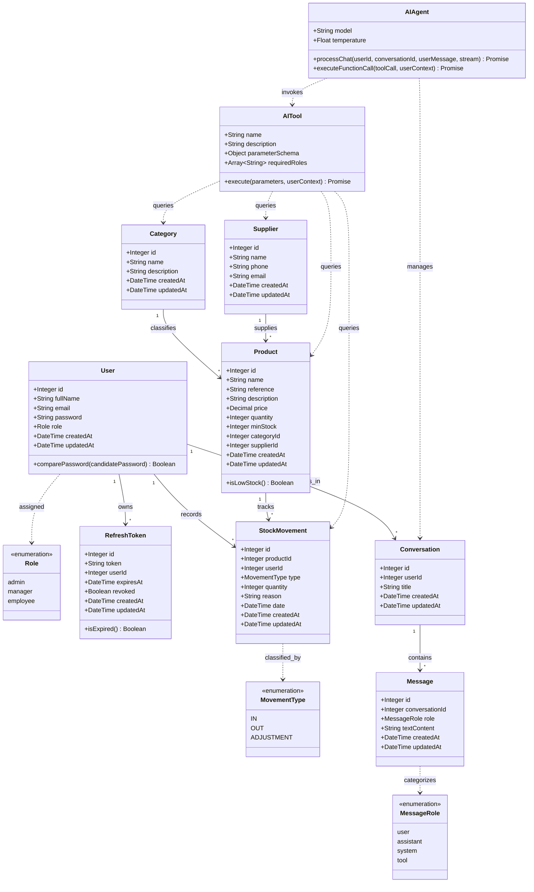

# StockMaster AI - Class Diagram

The following class diagram represents the domain model and AI integration architecture of the StockMaster AI backend.
In accordance with the project specifications, it focuses on the core inventory entities and function-calling AI components (without vector embeddings or notification tables).

